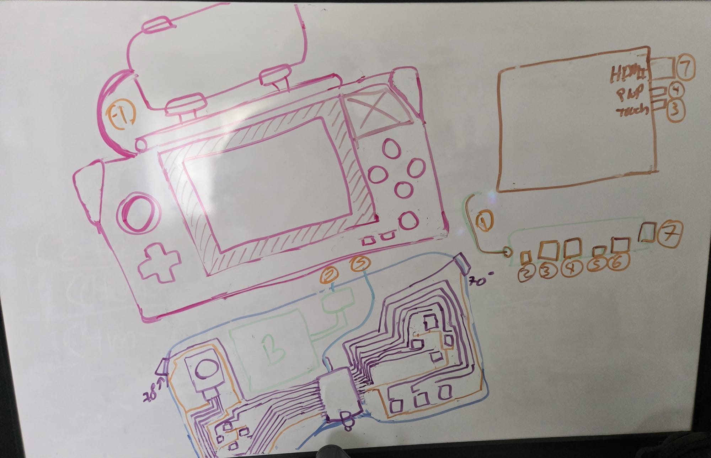
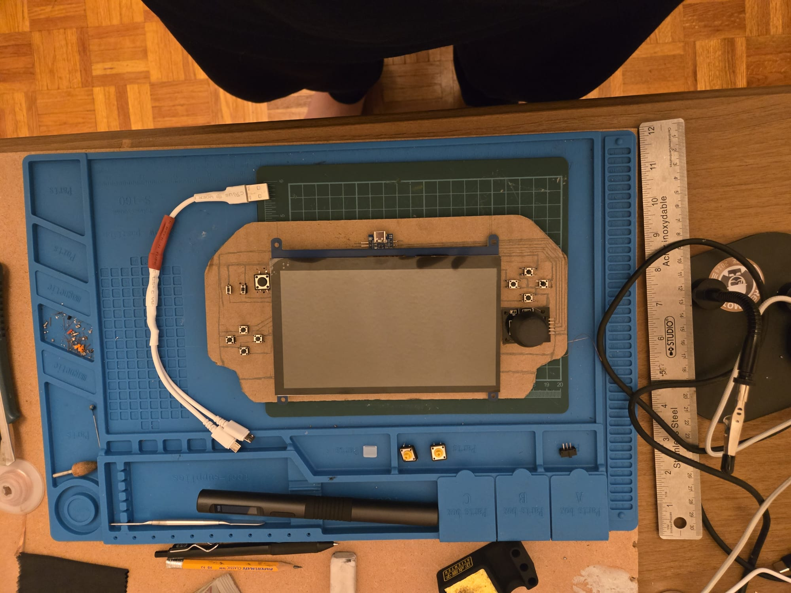

# V1 Phone-Based Prototype

## Overview

The V1 Phone-Based Prototype is the first physical development stage of OpenEmu Handheld.

The purpose of this prototype is to test the basic handheld concept using off-the-shelf components before more integrated electronics are developed.

The prototype uses an Android phone as the primary computing device while the handheld provides physical controls, a secondary display, display power, and the mechanical enclosure.

This prototype is intended to help validate:

- controller ergonomics
- button and joystick placement
- secondary display integration
- phone mounting
- battery operation
- USB-C connectivity
- internal electronics placement
- cable and wire routing
- enclosure dimensions
- practical 3D printing and assembly
- mechanical clearance and tolerance
- component stress during assembly
- compatibility with later parts and button extensions

---

## Development Status

**Prototype:** V1 Phone-Based Prototype  
**Project release:** `v0.1.x`  
**Mechanical revisions:** left `r12`, right `r01`  
**First concept documented:** 2026-10-04  
**Physical mock-up documented:** 2026-10-11  
**Status:** Experimental / Pre-alpha

The design is still under active development. Mechanical dimensions, electronics placement, wiring, and individual components may change as testing continues.

Part revisions are tracked independently. A mechanically functional revision may still be replaced when it creates alignment, stress, assembly, or future-integration problems.

---

## Initial Concept Sketch



The image above is an early whiteboard concept used to plan the mechanical and electronic layout of the V1 prototype.

The sketch is not intended to represent exact dimensions or finalized electrical connections. It is primarily used to visualize how the major components could fit together before detailed CAD and electronics work is completed.

The sketch includes early concepts for:

- the overall handheld enclosure
- controller grip geometry
- the 7-inch secondary display
- phone positioning
- analog joystick placement
- D-pad placement
- face buttons
- additional control buttons
- internal electronics placement
- controller wiring
- wire-routing paths
- display connections
- power connections

### Original Numbered Sketch References

The numbered labels in the original sketch represented:

1. USB hub to phone
2. USB hub to battery
3. USB hub to display power
4. USB hub to display touch
5. USB hub to Arduino Pro Micro
6. N/A
7. USB hub to display HDMI

**Important:** the power portion of this early sketch has been superseded by the current V1 power plan below. The battery is no longer intended to connect through the USB hub.

---

## Full-Size Cardboard Mock-Up



A full-size cardboard prototype was built before committing to the complete printed enclosure.

The mock-up is used to establish the real physical relationship between the:

- 7-inch display
- left and right controls
- joystick and button reach
- overall handheld width
- component placement
- cable routing space
- connector clearance
- future enclosure geometry

The purpose is not cosmetic fidelity. It is a low-cost, life-size integration test that makes it possible to catch ergonomic and packaging problems before spending time on larger prints.

---

## Current V1 Power Architecture

The current prototype separates display power from the phone's USB peripheral path.

```text
DISPLAY POWER

USB-C charger
     │
     ▼
charge / boost module
     │
     ├── battery connection
     │
     └── regulated 5 V output
                │
                ▼
          7-inch display


PHONE / SIGNAL PATH

Android phone
     │
     ▼
USB-C hub
  ├── HDMI ───────────────► display video
  ├── USB ────────────────► Pro Micro / controller
  └── USB ────────────────► display touch, if required
```

The phone is therefore not intended to charge the handheld battery through the hub in the current V1 layout.

Before final wiring, the exact battery, input, and 5 V output pads on the selected charge/boost module must be verified from the board markings or documentation. Lithium battery polarity should also be verified before connection.

---

## Mechanical Iteration Approach

The design process is integration-focused rather than stopping at the first revision that functions.

A revision can pass its immediate functional test but still be revised if it:

- places continuous tension on components
- shifts button or connector alignment
- reduces cable bend clearance
- makes later assembly more difficult
- prevents future mounting features
- relies on oversized geometry rather than correct tolerances

### Left-Side Revision Notes

**r10**

- Functionally successful for the intended button/wire organization.
- Demonstrated that the basic arrangement could work.

**r11**

- Increased dimensions by roughly 5% to gain clearance.
- Still functioned, but the larger geometry introduced alignment issues.
- Misalignment could place unwanted mechanical tension on components.
- Retained as development history rather than the preferred current revision.

**r12**

- Revises the geometry to remove the stress/alignment issue identified in r11.
- Keeps the required functional clearances without simply scaling the entire part.
- Adds a feature intended to help mount button extensions later in the build.
- Current left-side revision.

### Right-Side Revision Notes

**r01**

- First physical right-side prototype.
- Useful for establishing the initial geometry.
- Not considered final; a second revision is planned after the left side is completed and its lessons can be carried over.

---

## Current Mechanical Files

Left side:

```text
hardware/controller-left/printable/left-controller-r10.3mf
hardware/controller-left/printable/left-controller-r11.3mf
hardware/controller-left/interchange/left-controller-r12.obj
hardware/controller-left/interchange/left-controller-r12.mtl
hardware/controller-left/interchange/left-controller-layout-sketch.dxf
```

Right side:

```text
hardware/controller-right/printable/right-controller-r01.3mf
hardware/controller-right/interchange/right-controller-layout-sketch.dxf
```

Editable native CAD and a printable `r12` export should be added when available rather than treating an older `.3mf` as the current source model.
